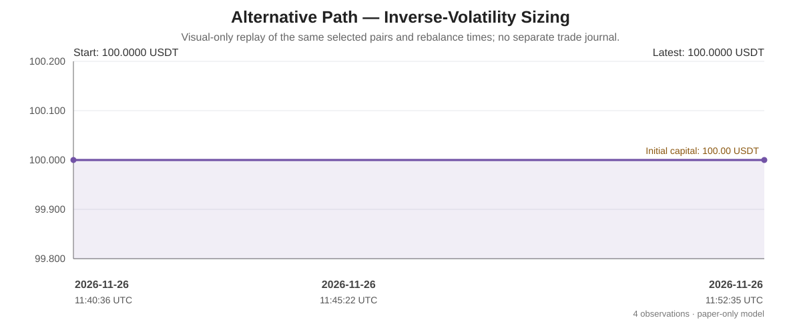

# ACTIVE PAPER STATUS — VOLUME PRICING $100 USDT

**🟢 ACTIVE · PAPER ONLY · NO LIVE ORDERS**

**Correct workflow:** [Open active workflow](https://github.com/takenthatusernameis-collab/VOLUME-PRICING/actions/workflows/volume-pricing-paper-cycle.yml)

- Account: `mexc-usdt-forward-volume-pricing-coinpaprika-100usdt-v2`
- Strategy generation: `volume-to-market-cap-first-positive-negative-coinpaprika-v2`
- Starting capital: **100.00000000 USDT**
- Account state: **INITIALIZED — FORWARD PAPER**
- Last report build: 2026-11-26 19:29:18 UTC
- Latest workflow run: [45883901412](https://github.com/takenthatusernameis-collab/VOLUME-PRICING/actions/runs/45883901412) · run #19, attempt 1 · failure · push
- Latest processed daily candle: —
- Latest account event: 2026-11-26 19:29:00 UTC
- Primary execution journal: [PAPER_TRADE_JOURNAL.md](PAPER_TRADE_JOURNAL.md)

## MEXC universe and data coverage

- Coverage state: **READY**
- Active USDT-settled cross-margin perpetuals: 1087
- Strategy-eligible crypto/unclassified contracts: 611
- Excluded tokenized-stock suffix contracts (overlaps category counts): 446
- Excluded non-crypto categories: {'commodity': 13, 'equity': 139, 'fx': 6}
- MEXC tickers received: 1087
- Missing tickers: 0
- History bootstrap remaining: 0
- API failures: 0
- Latest completed daily candle (UTC ms): 1795564800000
- Portfolio decision: `FAILED`
- Market-cap provider: coinpaprika+coingecko — Powered by CoinPaprika; Powered by CoinGecko
- Fresh market-cap matches: 514/611
- Market-cap API calls: CoinPaprika 13/642; CoinGecko 8/8

### Volume-to-market-cap ranking

Numerator: MEXC rolling 24-hour USDT quote turnover. Denominator: circulating market capitalization in USD.

**Highest-ranked positive 24-hour change candidates (long side):**
- Cycle error: `KeyError: 'distance_pct'`
- ANTHROPIC_USDT: ratio=786.8913690582990141233043023%, MEXC 24h change=0.0057, market-cap source=coinpaprika match=exact_coinpaprika_top_2000
- LAB_USDT: ratio=41.56803293038280829102194053%, MEXC 24h change=0.0118, market-cap source=coinpaprika match=exact_coinpaprika_top_2000
- INIT_USDT: ratio=41.03362116495392140119407201%, MEXC 24h change=0.0373, market-cap source=coinpaprika match=exact_coinpaprika_top_2000
- MANTRA_USDT: ratio=34.86338207571729101754872123%, MEXC 24h change=0.0116, market-cap source=coinpaprika match=exact_coinpaprika_top_2000
- GUA_USDT: ratio=26.61465662779736663469545358%, MEXC 24h change=0.0121, market-cap source=coinpaprika match=exact_coinpaprika_top_2000
- BIGTIME_USDT: ratio=23.35664691431738344465064869%, MEXC 24h change=0.0084, market-cap source=coinpaprika match=exact_coinpaprika_top_2000
- AKE_USDT: ratio=20.83495504714708670631952937%, MEXC 24h change=0.2164, market-cap source=coinpaprika match=exact_coinpaprika_top_2000
- MMT_USDT: ratio=15.54941316510286970867048254%, MEXC 24h change=0.0216, market-cap source=coingecko match=exact_coingecko_top_2000
- ME_USDT: ratio=12.38718328414892499183950853%, MEXC 24h change=0.0454, market-cap source=coinpaprika match=exact_coinpaprika_top_2000
- ESPORTS_USDT: ratio=10.95027541521371097661592367%, MEXC 24h change=0.0577, market-cap source=coinpaprika match=exact_coinpaprika_top_2000

**Highest-ranked negative 24-hour change candidates (short side):**
- BULLA_USDT: ratio=128.4022953120329142565825969%, MEXC 24h change=-0.2506, market-cap source=coinpaprika match=exact_coinpaprika_top_2000
- EVAA_USDT: ratio=127.4641770680571574700826153%, MEXC 24h change=-0.1561, market-cap source=coinpaprika match=exact_coinpaprika_top_2000
- SPY_USDT: ratio=123.8558875845940233109908926%, MEXC 24h change=-0.0002, market-cap source=coingecko match=exact_coingecko_top_2000
- BLESS_USDT: ratio=61.29427254139234356852581026%, MEXC 24h change=-0.097, market-cap source=coinpaprika match=exact_coinpaprika_top_2000
- MOVE_USDT: ratio=52.24460184878584758282850417%, MEXC 24h change=-0.02, market-cap source=coinpaprika match=exact_coinpaprika_top_2000
- DCTY_USDT: ratio=32.95821710860743740085364464%, MEXC 24h change=-0.0306, market-cap source=coinpaprika match=exact_coinpaprika_top_2000
- SI_USDT: ratio=26.00562091199370579375848406%, MEXC 24h change=-0.0183, market-cap source=coingecko match=exact_coingecko_top_2000
- ACE_USDT: ratio=23.24949770516972919165848001%, MEXC 24h change=-0.0057, market-cap source=coinpaprika match=exact_coinpaprika_top_2000
- SSV_USDT: ratio=14.88153099753811256437039937%, MEXC 24h change=-0.001, market-cap source=coinpaprika match=exact_coinpaprika_top_2000
- LISTA_USDT: ratio=13.98427509203390038153149396%, MEXC 24h change=-0.0063, market-cap source=coinpaprika match=exact_coinpaprika_top_2000

Portfolio transitions remain blocked until the complete eligible MEXC USDT universe passes the market-data gate.

## Current performance

| Metric | Value |
|---|---:|
| Initial capital | 100.00000000 USDT |
| **NAV** | **100.00000000 USDT** |
| Total return | +0.000% |
| Cash | 100.00000000 USDT |
| Unrealized P&L | +0.00000000 USDT |
| Fees paid | 0.00000000 USDT |
| Confirmed funding | +0.00000000 USDT |
| Gross exposure | 0.000× NAV |
| Net exposure | 0.000× NAV |
| Current drawdown from risk-window peak | +0.000% |
| Lifetime / cross-session maximum drawdown | +0.000% |
| Worst risk-session maximum drawdown | +0.000% |
| Sharpe ratio | Unavailable — sample gate not met |
| Sortino ratio | Unavailable — sample gate not met |
| Annualized daily volatility | Unavailable — sample gate not met |

### Maximum drawdown by risk session

| Session start (UTC) | Starting NAV | Latest NAV | Max drawdown | Marks |
|---|---:|---:|---:|---:|
| 2026-11-26 00:00:00 UTC | 100.00000000 | 100.00000000 | +0.000% | 10 |

## Open positions

| Symbol | Side | Quantity | Entry price | Mark | Notional (USDT) |
|---|---|---:|---:|---:|---:|
| No open positions yet | — | — | — | — | — |

## Primary path — equal exposure

The live forward-paper strategy sizes the long and short legs independently toward equal USDT notional (approximately 1× NAV per leg before lot rounding).

## Alternative path — volatility-weighted sizing

This chart is a **visual-only counterfactual**, not an executed account. It reuses the primary strategy’s exact selected symbols, sides and rebalance timestamps; only the notional split changes. No alternative trade journal is created.

At each rebalance, the quieter leg receives the larger share using inverse 30-completed-day realized volatility. The leverage overlay is the ratio of equal-exposure pair volatility to the inverse-volatility pair’s base estimated volatility. It increases modeled gross exposure only when the alternative has lower estimated volatility. Estimates use only data available at that rebalance.

- Latest long / short allocation: **50.0% / 50.0%** of alternative gross notional.
- Latest volatility-matching leverage multiplier: **1.000×**.
- Estimated base volatility reduction before leverage: **+0.00%**.
- Volatility observations used: **0**; status: `AWAITING_FIRST_PAIR`.

**Model limitations:** the counterfactual scales observed primary entry/exit fees and funding by shadow notional. It does not model additional nonlinear market impact, depth constraints, liquidation limits or exchange leverage caps for larger hypothetical exposure. It is not an executable leverage recommendation.

## Next workflow action

The next daily decision requires a newer completed UTC candle and a passing data-coverage gate.

The daily-candle watermark is not advanced by this report. Only the paper workflow can consume a completed candle after full-history and execution gates pass. A blocked or incomplete run remains visible.

## Historical separation

The initial provider-validation attempt is isolated from this CoinPaprika-only v2 account. The current immutable paper ledger is on the state-coinpaprika-v2 branch.

## Alternative-path reconstruction notes

- No reconstruction warnings.

This is the current live status page for the CoinPaprika-only v2 paper simulation.
